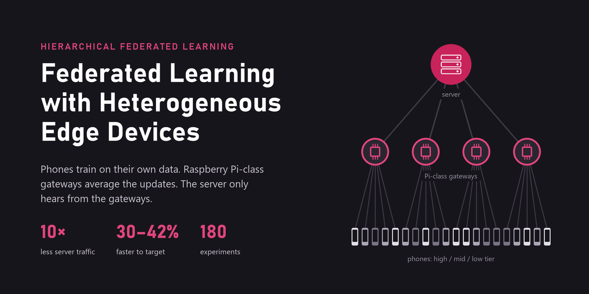
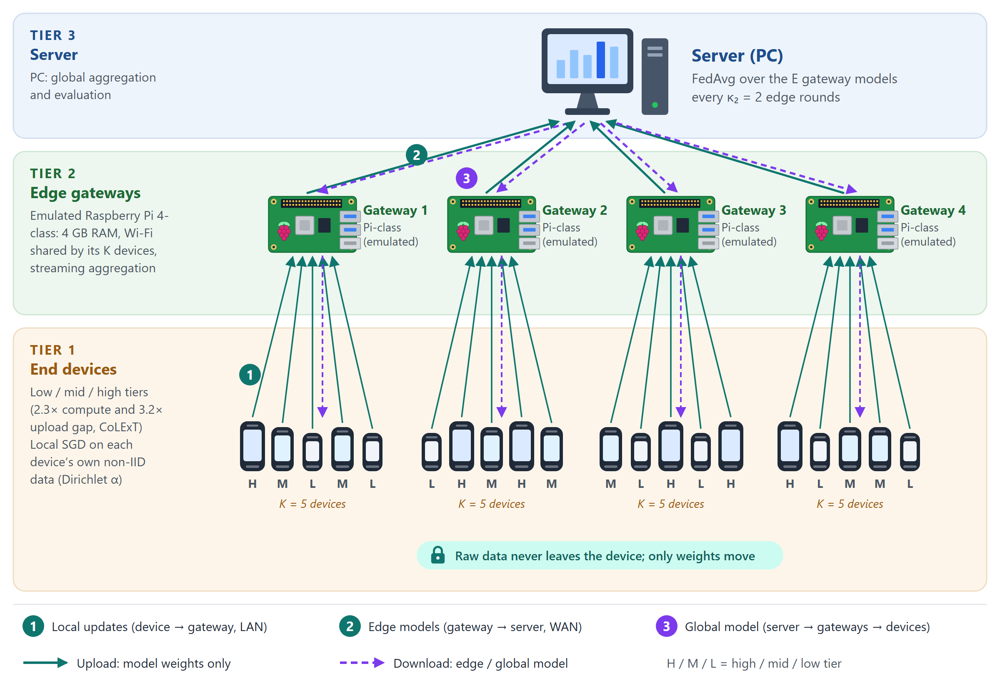
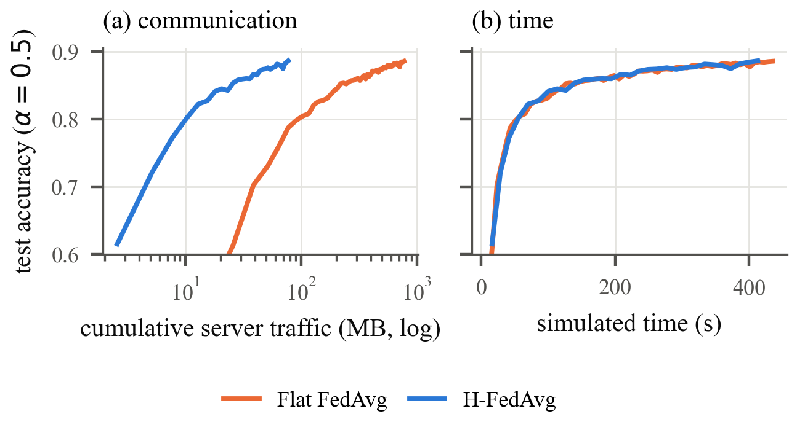
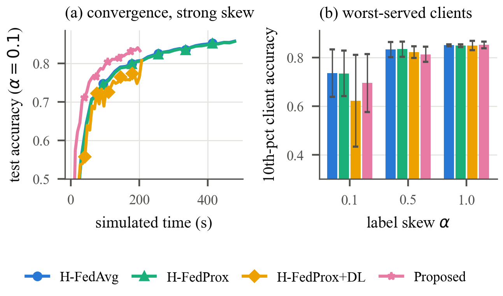
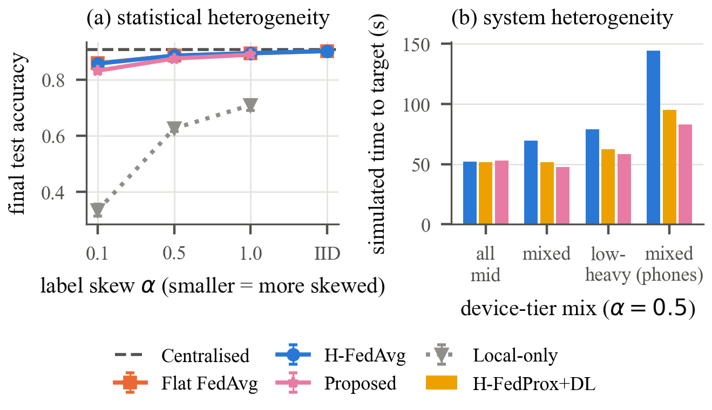
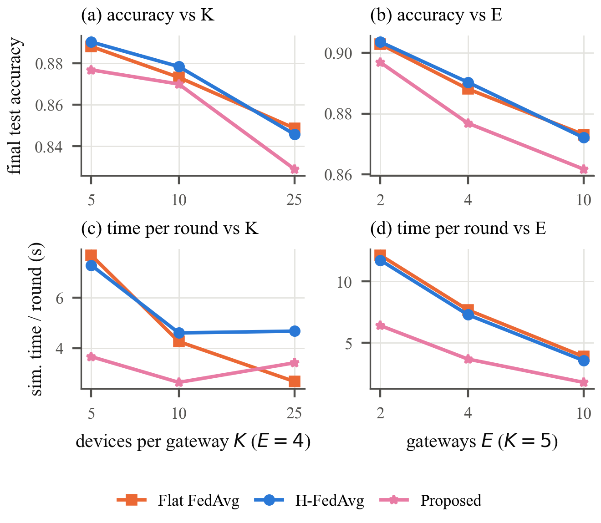
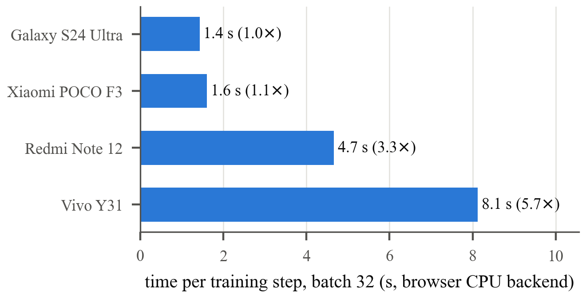
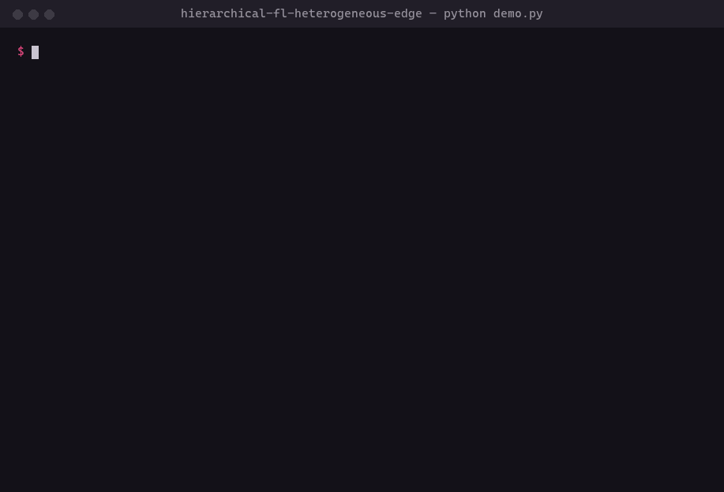

<p align="center">
  
</p>

<p align="center">
  
  
  
  
  
</p>

<p align="center">
  <a href="paper/main.pdf"><b>Paper (PDF)</b></a> ·
  <a href="docs/DESIGN.md"><b>Design spec</b></a> ·
  <a href="#live-demo"><b>Live demo</b></a> ·
  <a href="#reproduce-the-results"><b>Reproduce</b></a> ·
  <a href="phone_benchmark/index.html"><b>Phone benchmark</b></a>
</p>

---

Federated learning keeps personal data on the phone: the model goes to the data and only the weights come back. Most hierarchical FL papers add a middle tier of edge servers and assume those are powerful machines. We asked what happens when that middle tier is a **Raspberry Pi-class gateway** with shared Wi-Fi and 4 GB of RAM, and the phones under it are as different as real phones are.

Short version: the edge tier is worth having, slow phones should get less work rather than be dropped, and a Pi-class gateway runs out of Wi-Fi long before it runs out of CPU.

This repository has the simulator we built to find that out, the 180 experiments we ran with it, a browser benchmark we used to time training on real phones, and the IEEE-format paper with the results.

## Results at a glance

| Question | Answer |
|---|---|
| **What does heterogeneity cost?** | Skewed data costs accuracy: 1.4 / 2.0 / 5.2 points below centralised training as label skew grows (α = 1.0 / 0.5 / 0.1), and the worst-served 10% of devices lose most. Slow hardware costs time, not accuracy: 51% longer to reach the target with mostly slow devices, about 2× with our own phones' speeds. |
| **Is the edge tier worth it?** | Yes. Same accuracy as flat FedAvg (p = 0.86) with **10× less traffic at the server**. |
| **Do the slow-device mechanisms help?** | A deadline alone throws away about half the updates. Giving slow devices fewer local steps instead drops only 6%, reaches the target **30–42% sooner** and is the most accurate at equal time (+1.6 points, p = 0.017). It ends 1.35 points lower after an equal number of rounds, and a looser deadline recovers most of that. |
| **What breaks first as it scales?** | The gateway's shared Wi-Fi, well before its CPU or memory. At 25 devices per gateway, moving the model takes longer than training it, so about 10 devices per gateway is the practical limit. |
| **Does it hold up?** | With measured phone speeds the time saving grows to 42–57%. On CIFAR-10 the conclusions hold, with a sharper speed–accuracy trade-off under extreme skew. An int8 copy of the final model is 4× smaller (322 KB → 81 KB) and loses 0.05 points. |

The phones we timed differ by **5.7×** in time per training step (Galaxy S24 Ultra 1.4 s, POCO F3 1.6 s, Redmi Note 12 4.7 s, Vivo Y31 8.1 s), more than twice the 2.3× gap reported by the phone testbed we took our defaults from.

## How it works

<p align="center">
  
</p>

Each device is high, mid or low tier. Its compute and upload speeds come from the CoLExT phone testbed (or from our own phone measurements), with some random jitter each round.

The gateways are emulated Raspberry Pi 4-class nodes. Their devices share one Wi-Fi link, memory is capped at 4 GB, every update costs some aggregation time, and a broadband uplink connects them to the server. A gateway keeps a running weighted average, so it only ever holds two models in memory, however many devices report to it. Every second edge round the server averages the gateway models (HierFAVG-style).

Nothing in the simulator sleeps. It keeps its own clock and counts every byte, so a 60-round run takes a few minutes on a laptop GPU and still reports round latency and traffic at each tier.

To deal with slow devices we compare FedProx, a round deadline that drops late updates, and FedCompass-style adaptive workload: each device gets only as many local steps as it can finish before the deadline, with a safety margin for jitter.

[`docs/DESIGN.md`](docs/DESIGN.md) lists every parameter and where it comes from.

## Results

Flat and hierarchical FedAvg end at the same accuracy, but the hierarchy gets there with a tenth of the bytes reaching the server.

<p align="center"></p>

Under strong label skew, adaptive workload pulls ahead early (left). A deadline on its own hurts the worst-served devices most (right).

<p align="center"></p>

<details>
<summary><b>More figures: cost of heterogeneity, scaling, measured phones</b></summary>
<br>

Skewed data costs accuracy; slow hardware costs time.

<p align="center"></p>

Accuracy and time per round as the number of devices per gateway (K) and of gateways (E) grows. Past about 10 devices per gateway, the shared Wi-Fi makes rounds slower again.

<p align="center"></p>

Time per training step on the phones we measured.

<p align="center"></p>

</details>

## Live demo

`python demo.py` trains a small federation (2 gateways × 3 devices) in under a minute. It prints each device's tier and the classes it mostly holds, then one line per round while only weights cross the network.

<p align="center"></p>

## Engineering notes

The model's parameters are views into one flat GPU buffer, and local SGD (FedProx term included) runs on `torch._foreach` ops. Client updates and aggregation are then just vector arithmetic. One 60-round run takes a few minutes on a laptop RTX 5060, and we ran four at a time.

`sweep.py` starts runs a few seconds apart, writes each result atomically and retries anything that fails. That mattered: the full sweep hit CUDA out-of-memory errors and a four-hour laptop standby, and still lost no runs.

`analyze.py` rebuilds every results figure, LaTeX table and paired t-test in the paper straight from the run files, so the tables and plots can't drift from the data.

`phone_benchmark/` is a single web page. It trains the same CNN in the phone's browser with TensorFlow.js and reports the median time per step, so measuring a phone takes a link instead of an app.

## Reproduce the results

Requires Python 3.10+ and PyTorch. A CUDA GPU is optional but much faster.

```bash
pip install -r requirements.txt

# one experiment (downloads Fashion-MNIST into data/ on first use)
python run.py --method hier_proposed --alpha 0.5 --E 4 --K 5 --tiers mixed --seed 0

# the full grid, groups G1-G6: 180 runs, about 4-5 hours on an RTX 5060 laptop GPU with 4 workers
python sweep.py --groups G1,G2,G3,G4,G5,G6 --workers 4

# figures, tables and statistics for the paper
python analyze.py

# live demo and deployment check
python demo.py
python deploy_check.py
```

Methods: `centralised`, `local`, `flat_fedavg`, `hier_fedavg`, `hier_fedprox`, `hier_fedprox_dl`, `hier_proposed`. Add `--profile measured` to use our phones' speeds instead of the testbed defaults.

To build the paper: `cd paper && pdflatex main.tex && pdflatex main.tex`.

<details>
<summary><b>Repository layout</b></summary>

```
hfl/                 simulator: data partitioning, model, device and gateway profiles, FL algorithms
run.py               one experiment -> results/runs/<name>.json
sweep.py             the experiment grid, in parallel and resumable
analyze.py           figures, LaTeX tables and statistics from the run files
demo.py              live demo, 2 gateways x 3 devices
deploy_check.py      model size and accuracy in float32 and int8
phone_benchmark/     browser page that times training on a real phone
docs/DESIGN.md       research questions, parameters with sources, cost model, experiment grid
paper/               IEEE conference paper (LaTeX source and PDF)
results/             all 180 run files, summary.txt, stats.json
```

</details>

## Timing a real phone

Serve the benchmark on your network, open it on the phone and press **Run benchmark**:

```bash
python -m http.server 8000 --directory phone_benchmark
# then open http://<your-PC-IP>:8000 on the phone
```

The `measured` device profile reads one high, one mid and one low phone from `phone_benchmark/measurements.json`. Extra phones go in `measurements_extra.json`, which only feeds the phone-speed figure.

## Limitations

The gateways are emulated from Raspberry Pi 4 specifications rather than measured on a board, phone speeds come from a browser benchmark, and links have fixed rates with no contention or packet loss. The model is small (80,602 parameters), so gateway memory never becomes the constraint. The paper's discussion section covers what each of these means for the results.

## Citation

```bibtex
@misc{shah2026hfl,
  title        = {Federated Learning with Heterogeneous Edge Devices: A Three-Tier Hierarchical
                  Federated Learning Framework for Privacy-Preserving Learning across Heterogeneous
                  Phones, Raspberry Pi-Class Edge Gateways and a Server},
  author       = {Shah, Immad and Mansoor, Sarim},
  year         = {2026},
  howpublished = {\url{https://github.com/D3aThNdDeMiSe/hierarchical-fl-heterogeneous-edge}},
  note         = {Edge Computing course project, FAST-NUCES Islamabad}
}
```

## Authors

**Immad Shah** and **Sarim Mansoor**, Department of Artificial Intelligence, FAST-NUCES Islamabad. Built for the Edge Computing course (R&D track), Fall 2026.
